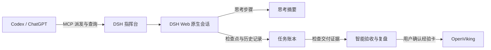

# DSH Plugin Suite

面向 Windows 上 DSH Web 的本地工具集。可以从 Codex 或 ChatGPT 派发任务，在 DSH 中看进展、恢复工作和验收交付物，并把可复用的经验存入 OpenViking。各插件可以独立安装。

| 组件 | 功能 | 目录 |
| --- | --- | --- |
| DSH 指挥台 | 从 Codex 或 ChatGPT 经 MCP 发起、跟踪和核对原生 DSH 任务 | [dsh-desktop](dsh-desktop/) |
| 思考摘要 | 每段思考结束后显示中文摘要，可选择摘要模型 | [dsh-thinking-summary](dsh-desktop/integrations/dsh-thinking-summary/) |
| 任务账本 | 查看任务与检查点，手动恢复，全量整理历史，智能验收及经验入库 | [dsh-workspace-ledger](dsh-desktop/integrations/dsh-workspace-ledger/) |
| 联动启动 | 从同一个窗口启动和停止 DSH Web、OpenViking 与 ChatGPT MCP 隧道 | [openviking-local](openviking-local/) |

## 各组件如何运作



### DSH 指挥台：从聊天派发本机任务

- **接收任务。** 在 Codex 或 ChatGPT 中说明目标、工作区和验收要求。指挥台通过 MCP 把请求交给本机 DSH，创建一个原生会话，沿用 DSH 的模型、工具和审批规则。
- **跟踪结果。** `bridge_health` 检查连接，`send_task` 返回任务编号，`wait_task` 或 `get_status` 查询进展。任务结束后，`get_result` 取回结果。断线导致派发结果不明时会保留待核对状态，防止重复执行。
- **连接方式。** 本地 Codex 可以通过 stdio 直接访问桥接。ChatGPT 网页端可通过 Secure MCP Tunnel 连接同一个本机桥接。

[配置指挥台](dsh-desktop/README.md)

### 思考摘要：把每一步变成可读的进展

- **何时生成。** 插件监听当前 DSH 会话的步骤事件。一段思考结束后，使用所选摘要模型生成一行计划和一段中文摘要。
- **在哪里看。** 计划显示在原生思考状态旁，摘要卡片显示在对应步骤下。摘要请求独立于主任务上下文。
- **如何选模型。** 在 DSH 的「设置 → 思考摘要」中选择提供商、模型、输出上限和最大尝试次数。模型支持 `off` 时关闭摘要调用的思考模式，否则沿用提供商默认设置。

[查看思考摘要设置](dsh-desktop/integrations/dsh-thinking-summary/MODEL-SETTINGS.md)

### 任务账本：记录进度、恢复工作和验收交付物

- **记录与整理。** Agent 通过账本工具保存目标、检查点、文件证据和下一步。已有会话也可以手动整理。插件从早到晚分段读取用户与助手正文和工具结果摘录，进度条显示已处理段数，全部分段通过校验后统一保存。
- **恢复。** 会话顶部的「任务账本」显示当前对话的任务，侧栏入口可跨对话浏览。打开恢复详情会核对已登记文件的变化，点击「继续原对话」或「新对话接手」才会派发继续消息。
- **验收与复盘。** 模型根据任务要求和已登记的交付物安排检查。程序执行可直接核对的检查，模型判断附上可回读的文本证据，证据不足的项留待人工核验。验收报告和任务完成状态分别记录。报告保存后，模型据此生成整改建议和经验草稿。
- **经验入库。** 经验卡可以查看依据、编辑和预览。勾选并确认后，以 Markdown 资源写入 OpenViking，账本保存资源回执及回读、检索状态。

[查看账本用法和证据规则](dsh-desktop/integrations/dsh-workspace-ledger/README.md)

### 联动启动：用一个窗口管理三项服务

联动脚本等待 OpenViking 就绪，再启动 DSH Web。DSH 开始监听后，脚本启动已配置的 ChatGPT MCP 隧道并打开 DSH 页面。关闭启动窗口或按 `Ctrl+C` 时，三项服务一同退出。只关闭浏览器标签页时，服务会继续运行。

[配置 OpenViking 和联动启动](openviking-local/README.md)

## 一个使用例子

在 ChatGPT 里让指挥台派发「统计 input.txt 的非空行，并验证文件有 12 个非空行」。在 DSH Web 中可看每一步的中文摘要。任务完成后，打开账本运行智能验收，查看程序实际测到的数字和模型引用的证据。如果发现可复用的核对步骤，可以把它整理成一张经验卡，预览后再写入 OpenViking。

摘要、历史整理和模型验收会把相应内容发送给所选的模型提供商。工作区账本、桥接凭据和 OpenViking 数据库保存在本机。

## 安装 DSH Web 插件

本仓库以 DSH `0.2.2-rc.1` 和 Node.js 24 为验证环境。先在本机初始化 DSH 的 Web profile。在仓库根目录用 PowerShell 执行：

```powershell
$summary = (Resolve-Path './dsh-desktop/integrations/dsh-thinking-summary').Path.Replace('\','/')
$ledger = (Resolve-Path './dsh-desktop/integrations/dsh-workspace-ledger').Path.Replace('\','/')
dsh plugin --profile web add "file:$summary"
dsh plugin --profile web add "file:$ledger"
```

重启 DSH Web 并刷新。思考摘要在设置页选择模型，任务账本在会话顶部打开。经验入库需要单独运行 OpenViking。

## 验证源码

```powershell
node --test dsh-desktop/test/*.test.mjs
node --test dsh-desktop/integrations/dsh-thinking-summary/test/*.test.mjs
node --test dsh-desktop/integrations/dsh-workspace-ledger/test/*.test.mjs
node --test openviking-local/test/config.test.mjs
```

插件测试使用本机 DSH 依赖。DSH 安装在 npm 默认位置以外时，可通过 `DSH_INSTALL` 指定其包目录。

## 许可证与来源

本仓库新增的代码按 [MIT 许可证](LICENSE) 发布。下列上游组件保留各自的版权声明和许可证。

思考摘要基于 [Rosmarinus-Young/dsh-thinking-summary](https://github.com/Rosmarinus-Young/dsh-thinking-summary)，保留 [MIT 许可证](dsh-desktop/integrations/dsh-thinking-summary/LICENSE)。任务账本借用了 [dsh-board](https://github.com/fenglufa/dsh-board) 的数据模型，详见[来源说明](dsh-desktop/integrations/dsh-workspace-ledger/UPSTREAM.md)。指挥台的 DSH 宿主桥接基于 [BeforeWave/dsh-with-chatgpt](https://github.com/BeforeWave/dsh-with-chatgpt)，保留 [MIT 许可证](dsh-desktop/vendor/LICENSE)。

密钥、运行状态和 OpenViking 数据保存在本机，按各组件说明重新配置。
